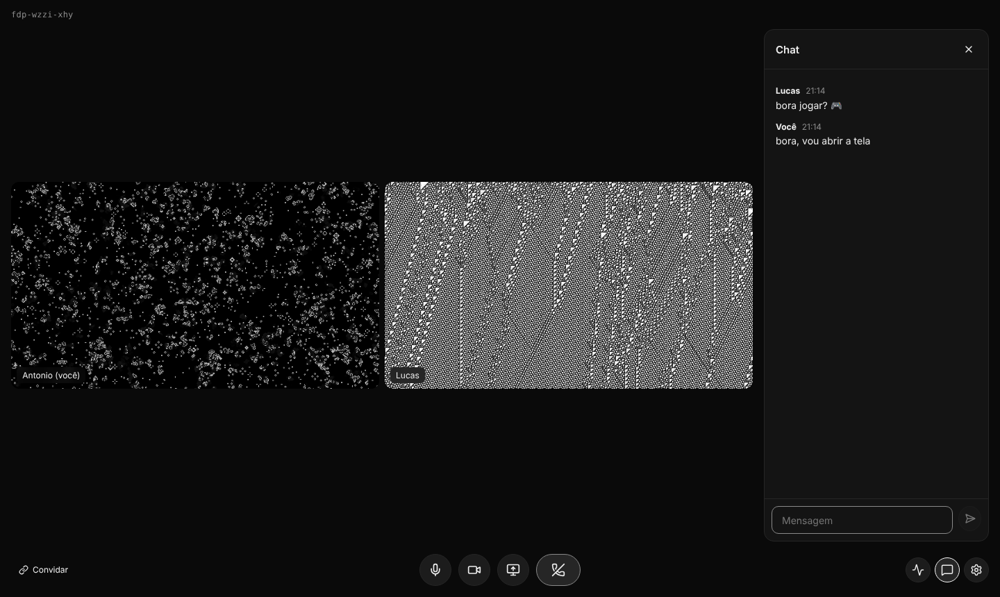

# Simple Call

Chamadas leves pra jogar e transmitir com os amigos. Estilo Meet: você cria a call, manda o link e pronto. Sem servidor, sem canal, sem conta.



## O que já funciona

- Criar uma call e entrar por link ou código (`abc-defg-hij`), só com o nome.
- Microfone e câmera, com prévia antes de entrar.
- Transmissão de tela em 4 qualidades: 1080p 60, 720p 60, 1080p 30 e 720p 30.
- Chat simples dentro da call (as mensagens somem quando a call acaba).
- Qualidade do áudio ajustável (24 a 128 kbps, estéreo), cancelamento de eco, supressão de ruído, DTX e RED.
- Escolha de codec da transmissão (H.264, VP9, AV1, VP8).
- Painel de estatísticas: ping, resolução, FPS, bitrate e perda de pacotes de cada transmissão.
- Tema escuro e claro, só em escala de cinza. Funciona no celular.
- Atalhos: `M` microfone, `V` câmera, `S` transmitir tela, `C` chat.

## Como funciona

```
navegador ──HTTPS──> API (Node + Hono) ──> gera código da call e token de acesso
navegador <──WebRTC──> LiveKit (SFU) <──WebRTC──> amigos
```

Quem transmite manda o vídeo **uma vez** pro servidor de mídia ([LiveKit](https://github.com/livekit/livekit)), que repassa pra cada amigo sem reencodar. O servidor manda pra cada um só a resolução que cabe na tela dele (simulcast + adaptive stream), e camadas que ninguém está vendo param de ser enviadas (dynacast).

| Pasta | O que tem |
| --- | --- |
| `apps/web` | Front em React + Vite + TypeScript |
| `apps/server` | API que cria calls e assina tokens do LiveKit |
| `tools/livekit` | Baixa e roda o LiveKit em modo dev, sem instalar nada |
| `infra` | Docker Compose, config do LiveKit e Caddy pro deploy |

## Rodando no seu PC

Só precisa do **Node 22+** e do **Git**. Nada é instalado no sistema: o pnpm roda via `npx` e o servidor do LiveKit é baixado pra dentro do projeto (`tools/livekit/.bin`) na primeira vez.

```bash
git clone https://github.com/antonioinaciodev/simple-call
cd simple-call
npx pnpm@10 install
npx pnpm@10 dev
```

O `dev` sobe as três peças juntas: LiveKit (ws://localhost:7880), API (porta 3001) e o front em http://localhost:5173. Clique em **Nova call** e abra o mesmo link em outra aba ou navegador pra simular um amigo.

No Windows, na primeira vez o firewall pode perguntar se o `livekit-server` pode usar a rede: permita em redes privadas. No macOS o LiveKit não tem binário pronto; instale com `brew install livekit`.

Pra mudar portas ou chaves, copie `.env.example` pra `.env`.

## Limitações conhecidas

- **Áudio do jogo no Linux:** o navegador só consegue mandar o áudio de uma aba do Chrome junto com a tela, não o áudio do sistema ou de um jogo. No Windows funciona ao escolher "Tela inteira". O app desktop (fase 4) resolve isso.
- **Push-to-talk com o jogo em foco** também depende do app desktop, porque o navegador só recebe teclas com a aba em foco.
- O deploy em `infra/` ainda é um rascunho e não foi testado num servidor de verdade.

## Roadmap

- [x] Fase 1: MVP web (call por link, mic, câmera, tela, chat, UI em escala de cinza)
- [x] Fase 2 (parcial): ajustes de áudio, codec e painel de estatísticas
- [ ] Fase 2: volume por pessoa, áudio de um dispositivo de entrada como áudio da transmissão
- [ ] Fase 3: deploy na Oracle Cloud (São Paulo) com domínio e HTTPS
- [ ] Fase 4: app desktop em Electron (áudio só do jogo, push-to-talk global)
- [ ] Depois: senha ou sala de espera na call
