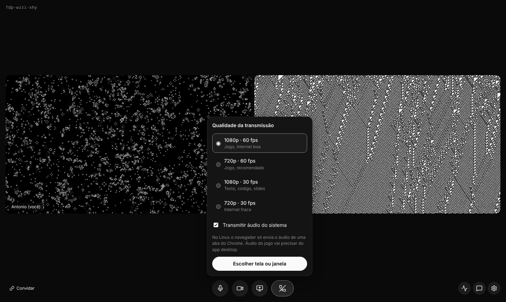
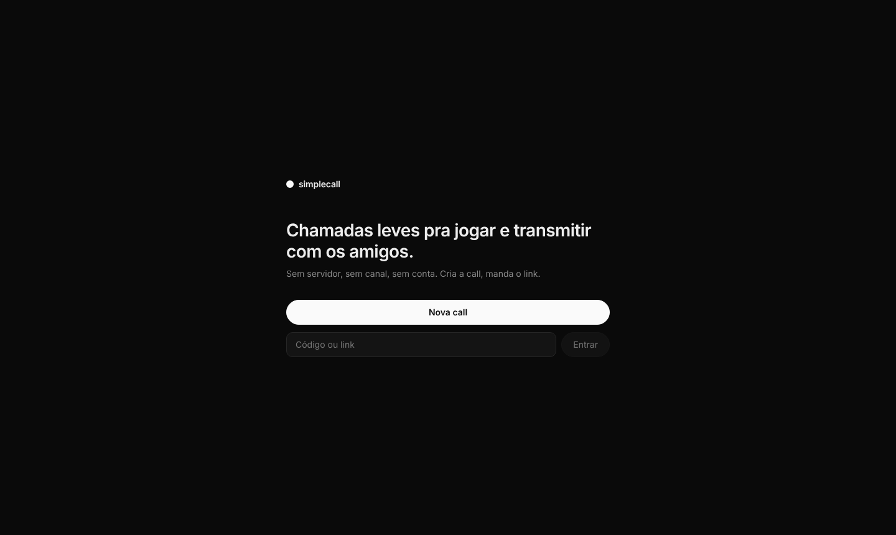
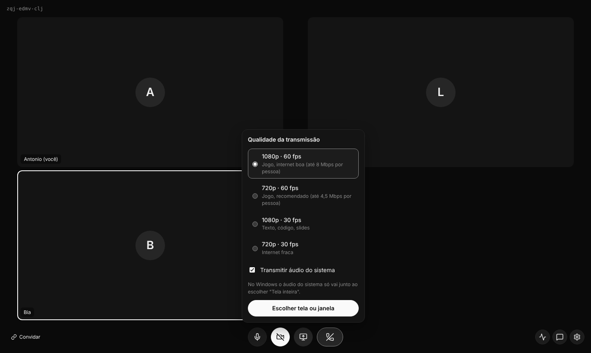
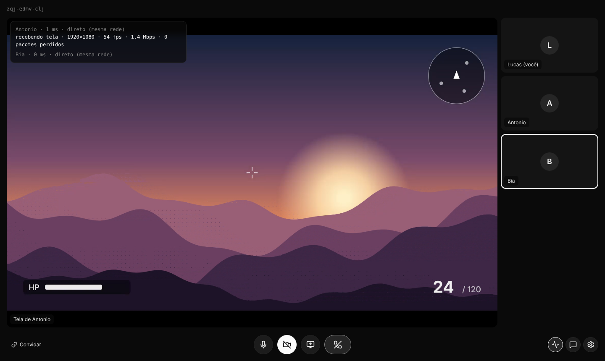
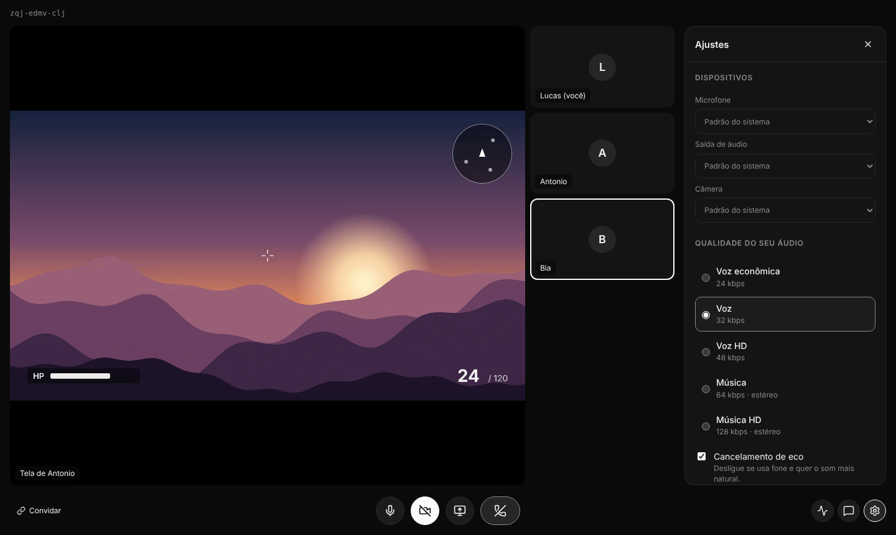
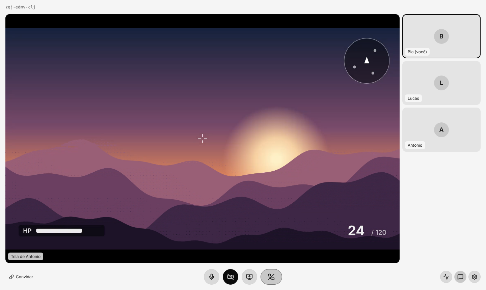
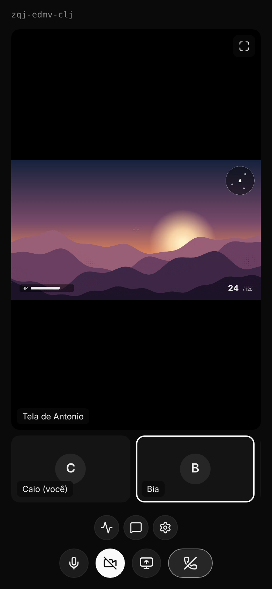

# Simple Call

Chamadas leves pra jogar e transmitir com os amigos. Estilo Meet: você cria a call, manda o link e pronto. Sem servidor, sem canal, sem conta.

Áudio, vídeo e chat vão **direto entre os navegadores** (WebRTC P2P). A hospedagem fica toda no plano grátis da Cloudflare.

**[Abrir o app](https://simplecall.antonioinaciodev.workers.dev)** · [Baixar pra Windows, Linux e Android](https://github.com/antonioinaciodev/simple-call/releases/latest) · [Como funciona](#como-funciona) · [Rodar no PC](#rodando-no-seu-pc) · [Colocar no ar](docs/DEPLOY.md) · [Arquitetura](docs/ARQUITETURA.md)

[](https://github.com/antonioinaciodev/simple-call/actions/workflows/ci.yml)



## O que já funciona

- **Call por link:** crie uma call e entre pelo link ou pelo código (`abc-defg-hij`), só com o nome. Até 6 pessoas por call.
- **Microfone e câmera**, com prévia antes de entrar e escolha de dispositivo (mic, câmera e saída de áudio).
- **Transmissão de tela** em 1080p 60, 720p 60, 1080p 30 ou 720p 30, com áudio do sistema no Windows.
- **Chat** dentro da call. As mensagens somem quando a call acaba.
- **Volume de cada um:** cada amigo tem o próprio volume (de 0 a 200%), que fica salvo pro próximo encontro. A transmissão tem um volume separado das vozes.
- **Desligar o som da call** (como o ensurdecer do Discord): corta tudo que você ouve e o mic junto. Ao religar, o mic volta como estava.
- **Sons da call** quando alguém entra, sai, muta ou desliga o som, e quando você muta. Dá pra desligar nos ajustes.
- **Áudio ajustável:** de 24 a 128 kbps (estéreo nas opções de música), cancelamento de eco, supressão de ruído, ganho automático e DTX.
- **Codec da transmissão:** automático (o melhor que a placa de vídeo de quem transmite e de quem assiste aguenta), ou H.264, VP9, AV1 e VP8 na mão.
- **Encoder ajustado pra jogo:** a voz vai com redundância (aguenta perda de pacote no Wi-Fi e no 4G), a transmissão tem prioridade sobre a câmera, o áudio do jogo vai em estéreo sem cortes e, com pouca banda, a imagem encolhe um pouco em vez de perder quadros.
- **Estatísticas da conexão:** ping, rota (direta ou via TURN), resolução, FPS, bitrate e perda de pacotes.
- Contorno em quem está falando, tela cheia na transmissão (botão ou dois cliques) e tema escuro ou claro, só em escala de cinza.
- Funciona no celular. Os ajustes ficam salvos no navegador.
- **Apps pra Windows, Linux, Android e iOS** ([detalhes](docs/APPS.md)): no PC, seletor próprio de tela ou janela (com miniaturas) e áudio só do jogo, sem as vozes da call (Windows e Linux); no celular, escolha entre alto-falante, ouvido e fone, e o mic segue funcionando com o app em segundo plano.
- Atalhos: `M` microfone, `D` som da call, `V` câmera, `S` transmitir tela, `C` chat.

| | |
| --- | --- |
|  |  |
| Tela inicial | Qualidade da transmissão |
|  |  |
| Estatísticas da conexão | Ajustes |
|  |  |
| Tema claro | No celular |

## Como funciona

```
navegador ──WebSocket──> Cloudflare Worker ──> só apresenta as pessoas da call
navegador <────────── WebRTC P2P ──────────> amigo
```

O servidor só existe pra apresentar as pessoas: troca as mensagens de conexão e sai do caminho. Cada call é um Durable Object da Cloudflare, e a mídia nunca passa por ele. Por isso ele é leve e cabe no plano grátis.

Cada pessoa tem uma conexão direta com cada uma das outras. Quem transmite manda uma cópia da tela pra cada pessoa assistindo (até 8 Mbps cada no 1080p 60), então o P2P funciona melhor com poucas pessoas assistindo, que é o caso de jogar com os amigos.

Quando a conexão direta não rola (algumas operadoras com CGNAT, redes de empresa ou faculdade), um servidor TURN pode repassar a mídia. Ele é opcional e ainda não está ligado: veja o [guia de deploy](docs/DEPLOY.md#2-turn-opcional).

Os detalhes (sinalização, negociação, ajustes de qualidade) estão em [docs/ARQUITETURA.md](docs/ARQUITETURA.md).

## Estrutura do projeto

```
simple-call/
├── apps/
│   ├── desktop/          App de Windows e Linux (Electron) que abre o site
│   ├── mobile/           Apps de Android e iOS (Capacitor) que abrem o site
│   ├── web/              Front: React + TypeScript + Vite
│   │   └── src/
│   │       ├── components/   Telas e partes da interface (Home, PreJoin, Call, Chat...)
│   │       ├── hooks/        useSpeaking (quem está falando)
│   │       └── lib/          mesh.ts (malha P2P), presets de qualidade, estatísticas, preferências
│   └── worker/           Cloudflare Worker: API, sinalização e servidores STUN/TURN
│       └── src/
│           ├── index.ts      Rotas /api/*
│           ├── room.ts       Durable Object de cada call (WebSocket de sinalização)
│           └── rooms.ts      Código da call e validação do nome
├── docs/                 Deploy, apps, arquitetura e screenshots
├── wrangler.jsonc        Configuração da Cloudflare (fica na raiz pro deploy automático achar)
└── .github/workflows/    CI (typecheck e build em cada PR) e geração dos apps nas Releases
```

É um monorepo com [pnpm workspaces](https://pnpm.io/workspaces): cada pasta em `apps/` é um pacote com o próprio `package.json`.

## Rodando no seu PC

Só precisa do **Node 22+** e do **Git**. Nada é instalado no sistema: o pnpm roda via `npx` e o Wrangler (que simula a Cloudflare no seu PC) fica dentro do projeto.

```bash
git clone https://github.com/antonioinaciodev/simple-call
cd simple-call
npx pnpm@10 install
npx pnpm@10 dev
```

O `dev` sobe o Worker local (porta 3001) e o front em http://localhost:5173. Clique em **Nova call** e abra o mesmo link em outra aba ou navegador pra simular um amigo.

| Comando | O que faz |
| --- | --- |
| `npx pnpm@10 dev` | Sobe o Worker e o front com recarregamento automático |
| `npx pnpm@10 typecheck` | Confere os tipos do TypeScript nos dois apps |
| `npx pnpm@10 build` | Gera o site em `apps/web/dist` |
| `npx pnpm@10 run deploy` | Publica na Cloudflare (precisa do `build` antes) |

Pra testar o TURN no PC, copie `.dev.vars.example` pra `.dev.vars` e preencha. Pra rodar e gerar os apps, veja [docs/APPS.md](docs/APPS.md).

### Fluxo de trabalho

1. Cada mudança vai numa branch e vira um pull request.
2. O CI (GitHub Actions) roda o typecheck e o build no PR.
3. Depois do merge no `main`, a Cloudflare publica a versão nova sozinha em uns 2 minutos.

## Limitações conhecidas

- **Até 6 pessoas por call.** Como é P2P, cada pessoa a mais é mais uma conexão pra cada um.
- **Áudio do jogo pelo navegador:** no Linux o navegador só manda o áudio de uma aba do Chrome; no Windows, só com "Tela inteira" e junto com as vozes da call. O [app desktop](docs/APPS.md) manda só o áudio do jogo nos dois.
- **Push-to-talk com o jogo em foco** não dá pra fazer no navegador, porque ele só recebe teclas com a aba em foco.
- **Sem TURN por enquanto:** quem estiver numa rede que bloqueia conexão direta não vai conectar. Até agora ninguém precisou.

## Roadmap

- [x] MVP web: call por link, mic, câmera, tela, chat, interface em escala de cinza
- [x] Ajustes de áudio, codec e painel de estatísticas
- [x] Troca do servidor de mídia (LiveKit) por P2P direto entre os navegadores
- [x] Tudo hospedado na Cloudflare (Worker + Durable Objects)
- [x] Volume por pessoa, som de entrada e saída
- [x] Apps pra Windows, Linux, Android e iOS
- [x] Áudio só do jogo no app desktop (Windows e Linux)
- [x] Seletor de janelas com miniaturas e ajuste fino do encoder
- [ ] Página inicial com os downloads
- [ ] TURN, se alguém não conseguir conectar direto
- [ ] Senha ou sala de espera na call

## Licença

[MIT](LICENSE)
